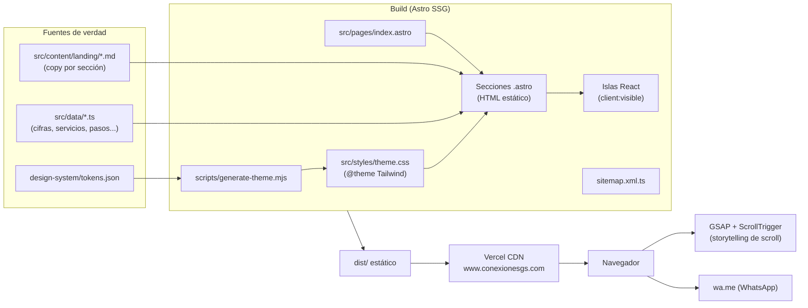
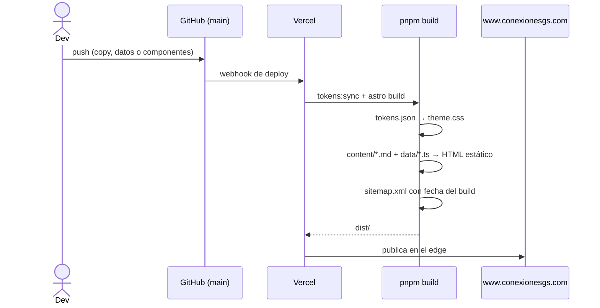
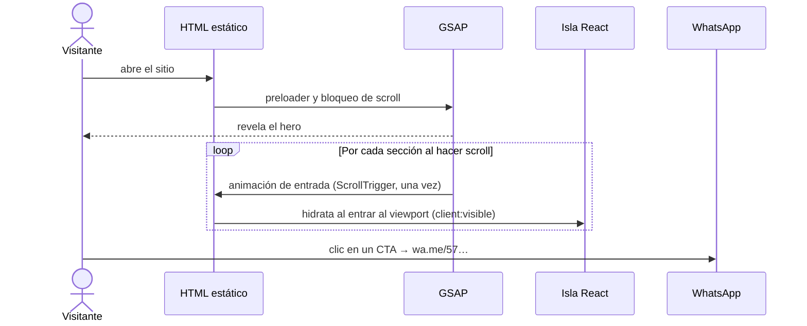

# G&S Conexiones Estratégicas — Landing

> Landing page de una sola página para G&S Conexiones Estratégicas, empresa familiar de transporte de carga en Antioquia, orientada a convertir visitas en conversaciones por WhatsApp.


**Producción:** [www.conexionesgs.com](https://www.conexionesgs.com)

---

## 1. Project Overview

G&S mueve carga industrial y es un eslabón clave de la cadena de reciclaje de PET, pero su presencia digital no reflejaba más de 37 años de experiencia. Este sitio cuenta esa historia como un recorrido de scroll —gancho, respaldo en cifras, servicios, flota, cobertura, diferenciales, impacto, proceso e historia—, y todo el recorrido empuja a un único llamado a la acción: escribir por WhatsApp.

El público son empresas industriales y de reciclaje que necesitan transporte confiable en el Valle de Aburrá, el Oriente antioqueño y, bajo requerimiento, el resto de Colombia.

---

## 2. Architecture Overview

### Diagram



### Architecture Decisions

#### ADR-001: Sitio estático con islas React solo donde hay interacción

- **Decisión:** Astro genera HTML estático; React se hidrata únicamente en los componentes interactivos (`AttributesCarousel`, `WhatWeDoCards`, `HistoryCarousel`, `HistoryTimeline`) y siempre con `client:visible`.
- **Contexto:** Es una landing de conversión donde el LCP pesa más que la interactividad. Una SPA completa enviaría JavaScript para contenido que no lo necesita.
- **Consecuencias:** El HTML llega listo y el JS de cada isla se carga solo al entrar al viewport. A cambio, el estado no se comparte entre islas; cada una es autónoma, y eso es aceptable porque las secciones no dependen entre sí.

#### ADR-002: El copy vive fuera de los componentes

- **Decisión:** Los titulares y subtítulos de cada sección están en una Content Collection (`src/content/landing/NN-seccion.md`, validada con Zod en `src/content.config.ts`). Los datos repetibles (cifras, servicios, pasos, atributos, hitos) están en `src/data/*.ts`, y el contacto de WhatsApp está centralizado en `src/data/contact.ts`.
- **Contexto:** El cliente ajusta textos con frecuencia; editarlos no debería obligar a tocar el marcado ni las animaciones.
- **Consecuencias:** Un cambio de copy es un diff de una línea en un `.md` o `.ts`. Agregar un campo nuevo exige actualizar el schema de la colección.

#### ADR-003: GSAP para el scroll global, Motion dentro de las islas

- **Decisión:** `src/animations/*.ts` usa GSAP + ScrollTrigger para las revelaciones de sección, el preloader, el header y la cortina de la flota. Motion se usa solo dentro de componentes React para micro-interacciones.
- **Contexto:** El storytelling de scroll necesita timelines orquestados sobre todo el documento, independientes de React. Las micro-interacciones de componente son más simples de declarar junto al JSX.
- **Consecuencias:** Hay dos librerías de animación, cada una con un dominio claro. Todas las animaciones respetan `prefers-reduced-motion` y animan solo `transform` y `opacity`.

#### ADR-004: Tokens de diseño generados, con prefijo propio

- **Decisión:** `design-system/tokens.json` es la fuente de verdad de color, tipografía, radios, motion y espaciado. `pnpm tokens:sync` genera `src/styles/theme.css` (no se edita a mano) y corre automáticamente antes de `dev` y `build`. El espaciado se emite como `--space-N`, no como `--spacing-N`.
- **Contexto:** En Tailwind v4, una variable `--spacing-N` dentro de `@theme` reemplaza ese paso de la escala: `gap-8` pasaba a valer 96px e `inset-0` 4px, lo que inflaba todos los espacios del sitio.
- **Consecuencias:** Las utilidades de Tailwind conservan su escala estándar de 4px. Los tokens de espaciado de marca quedan disponibles como `var(--space-N)` para casos puntuales.

#### ADR-005: Conversión por WhatsApp, sin backend

- **Decisión:** Todos los CTA (header, Nuestra ruta y footer) abren `wa.me` con el número del cliente. No hay formulario, base de datos ni servidor.
- **Contexto:** El cliente ya cierra negocios por WhatsApp; un formulario agregaría un paso, infraestructura y gestión de datos personales.
- **Consecuencias:** El costo de infraestructura es cero y no hay superficie de ataque del lado del servidor. No queda registro de leads dentro del sistema: el seguimiento ocurre en WhatsApp.

#### ADR-006: SEO y descubrimiento por LLMs desde el build

- **Decisión:** `site` en `astro.config.mjs` fija el dominio canónico (`https://www.conexionesgs.com`). A partir de él, el layout genera la URL canónica, Open Graph absoluto y JSON-LD (`WebSite` + `Organization`/`LocalBusiness`), y `src/pages/sitemap.xml.ts` genera el sitemap. `public/robots.txt` permite explícitamente a los rastreadores de IA y `public/llms.txt` resume el negocio en texto plano.
- **Contexto:** El sitio debe aparecer tanto en buscadores clásicos como en asistentes (ChatGPT, Claude, Perplexity, Gemini) que citan fuentes.
- **Consecuencias:** Cambiar de dominio implica tocar `site`, `robots.txt` y `llms.txt`. La redirección del dominio sin `www` a `www` se configura en Vercel, no en el repositorio, para evitar bucles con la configuración de dominios de la plataforma.

---

## 3. Scope & Boundaries

| En scope | Fuera de scope |
|---|---|
| Landing de una sola página con 9 secciones narrativas y footer | Páginas adicionales, blog o CMS |
| CTA único hacia WhatsApp desde el header, Nuestra ruta y el footer | Formulario de contacto, cotizador o captura de leads propia |
| Animaciones de scroll y micro-interacciones accesibles | Área de clientes, login o rastreo de envíos |
| Diseño responsive (móvil primero) con tokens de marca | Pagos o facturación |
| SEO técnico: canonical, OG, JSON-LD, sitemap, robots, `llms.txt` | Analítica o píxeles de seguimiento (no instalados) |
| Imágenes optimizadas a WebP con lazy-load | Versión en otros idiomas |

---

## 4. Tech Stack

| Tecnología | Versión | Rol | Por qué |
|---|---|---|---|
| Astro | 7.x | Framework / SSG | Static-first con islands: HTML sin JS por defecto, ideal para LCP |
| React | 19.x | Islas interactivas | Necesario para los componentes de 21st.dev/shadcn y los carruseles |
| Tailwind CSS | 4.x | Estilos | Utilidades con tokens de marca inyectados vía `@theme`, sin CSS suelto |
| GSAP + ScrollTrigger | 3.x | Animación de scroll | Timelines orquestados sobre el documento, independientes de React |
| Motion | 13.x | Micro-interacciones | Animación declarativa dentro de las islas React |
| Embla Carousel | 8.x | Carruseles | Ligero y headless; base del carrusel de shadcn |
| shadcn/ui (21st.dev) | — | Componentes UI | Componentes copiados al repo (`src/components/ui`), sin dependencia cerrada |
| sharp | 0.35 | Imágenes (dev) | Conversión a WebP (`pnpm images:webp`) y generación de la imagen OG |
| pnpm | 11.x | Paquetes | Versión fijada en `packageManager` para instalaciones reproducibles |
| Vercel | — | Hosting / CI | Deploy automático desde `main` y previews por rama |

---

## 5. Project Structure

```
.
├── astro.config.mjs            # dominio canónico (site), integración React y Tailwind
├── design-system/
│   ├── brand.md                # brief de marca: tono, público, mensajes (fuente de verdad)
│   ├── tokens.json             # tokens de diseño → generan src/styles/theme.css
│   └── hierarchy.md            # mapa de jerarquía visual por sección
├── scripts/
│   ├── generate-theme.mjs      # tokens.json → @theme de Tailwind (corre en dev/build)
│   └── images-to-webp.mjs      # assets/ (originales pesados) → public/ (WebP servible)
├── assets/                     # originales de foto/video del cliente; NO se publican
├── public/                     # se sirve tal cual: imágenes WebP, marca, robots, llms.txt, OG
├── src/
│   ├── pages/
│   │   ├── index.astro         # orden de las secciones = arco narrativo aprobado
│   │   └── sitemap.xml.ts      # sitemap generado en build desde `site`
│   ├── layouts/Layout.astro    # <head>: meta SEO, OG, JSON-LD, fuentes
│   ├── content/landing/        # copy por sección (01-hero.md … 09-final-cta.md)
│   ├── content.config.ts       # schema Zod de la colección `landing`
│   ├── data/                   # datos estructurados que alimentan las secciones
│   ├── components/
│   │   ├── layout/             # Header y Preloader (presentes en toda la página)
│   │   ├── sections/           # una sección por archivo; .tsx = isla React de esa sección
│   │   └── ui/                 # primitivas shadcn/21st.dev reutilizables
│   ├── animations/             # GSAP: scroll-story, preloader, header (scripts de página)
│   ├── assets/map/             # imágenes procesadas por astro:assets (mapa de cobertura)
│   ├── styles/                 # global.css (a mano) + theme.css (generado, no editar)
│   └── lib/utils.ts            # cn(): merge de clases Tailwind
├── docs/plans/                 # diseños y planes de cada iteración visual
├── config/tools.config.json    # herramienta asignada a cada rol (animación, deploy, etc.)
├── CLAUDE.md                   # instrucciones del flujo de diseño asistido por IA
└── .claude/skills/             # skills por fase: brainstorming → build/deploy
```

La organización separa **contenido** (`content/`, `data/`), **presentación** (`components/`) y **comportamiento** (`animations/`). Una sección se ubica por su nombre en las tres carpetas, y cambiar una capa no obliga a tocar las otras.

---

## 6. Data Flow

### Del contenido a producción



### Recorrido del visitante



---

## 7. Setup & Installation

### Requisitos previos

- Node.js >= 22.12
- pnpm 11 (vía Corepack)

### Instalación

```bash
git clone https://github.com/ariasalzateg237-GYS/landing-conexiones-estrategicas.git
cd landing-conexiones-estrategicas

corepack enable   # una vez por máquina
pnpm install
pnpm dev          # http://localhost:4321
```

### Scripts disponibles

| Comando | Descripción |
|---|---|
| `pnpm dev` | Sincroniza tokens y levanta el servidor de desarrollo |
| `pnpm build` | Sincroniza tokens y genera el sitio estático en `dist/` |
| `pnpm preview` | Sirve `dist/` localmente para revisar el build |
| `pnpm tokens:sync` | Regenera `src/styles/theme.css` desde `design-system/tokens.json` |
| `pnpm images:webp` | Convierte imágenes de `assets/` a WebP en `public/` (`--quality`, `--max-width`, `--force`) |

### Tareas frecuentes

| Quiero… | Edito |
|---|---|
| Cambiar un titular o subtítulo | `src/content/landing/NN-seccion.md` |
| Cambiar cifras, servicios, pasos o atributos | `src/data/*.ts` |
| Cambiar el número de WhatsApp | `src/data/contact.ts` |
| Cambiar colores, fuentes o radios | `design-system/tokens.json` → `pnpm tokens:sync` |
| Agregar una foto | Original en `assets/`, luego `pnpm images:webp` |
| Reordenar secciones | `src/pages/index.astro` (revisar antes `design-system/brand.md`) |

### Variables de entorno

El sitio no usa variables de entorno: es estático y los datos públicos (dominio y contacto) están versionados en el código.

---

## 8. Despliegue

- **Producción:** cada push a `main` se publica en Vercel en `https://www.conexionesgs.com`.
- **Previews:** cada rama o PR genera una URL de preview para aprobación del cliente.
- **Dominio:** `conexionesgs.com` redirige con 308 a `www.conexionesgs.com` (configurado en *Vercel → Settings → Domains*).
- **Después de un cambio de dominio o de estructura:** reenviar `https://www.conexionesgs.com/sitemap.xml` en Google Search Console y Bing Webmaster Tools.

---

## 9. Contributing

### Commits

[Conventional Commits](https://www.conventionalcommits.org/) con la descripción en español:

```
feat: quita las líneas de Nuestra ruta en móvil
fix: reduce la tipografía de las cards de atributos en móvil
chore: actualiza el registro de skills
```

### Principios no negociables

- **Accesibilidad:** respetar `prefers-reduced-motion`, contraste AA, `alt` en toda imagen y un solo `<h1>`.
- **Performance:** LCP < 2.5 s; animar solo `transform` y `opacity`; imágenes en WebP con `loading="lazy"` fuera del primer viewport.
- **Propósito comercial:** cada sección informa, genera confianza o empuja al CTA. Lo que no sirva a eso no entra.
- **No editar archivos generados:** `src/styles/theme.css` se sobrescribe en cada `tokens:sync`.

### Flujo de diseño asistido por IA

El repositorio nació de una plantilla de agente de diseño. `CLAUDE.md` define 7 fases (brainstorming → jerarquía → diseño visual → imágenes → video → animación → build) con una skill por fase en `.claude/skills/`, y `config/tools.config.json` declara qué herramienta cumple cada rol. Los cambios visuales grandes se documentan primero en `docs/plans/`.
